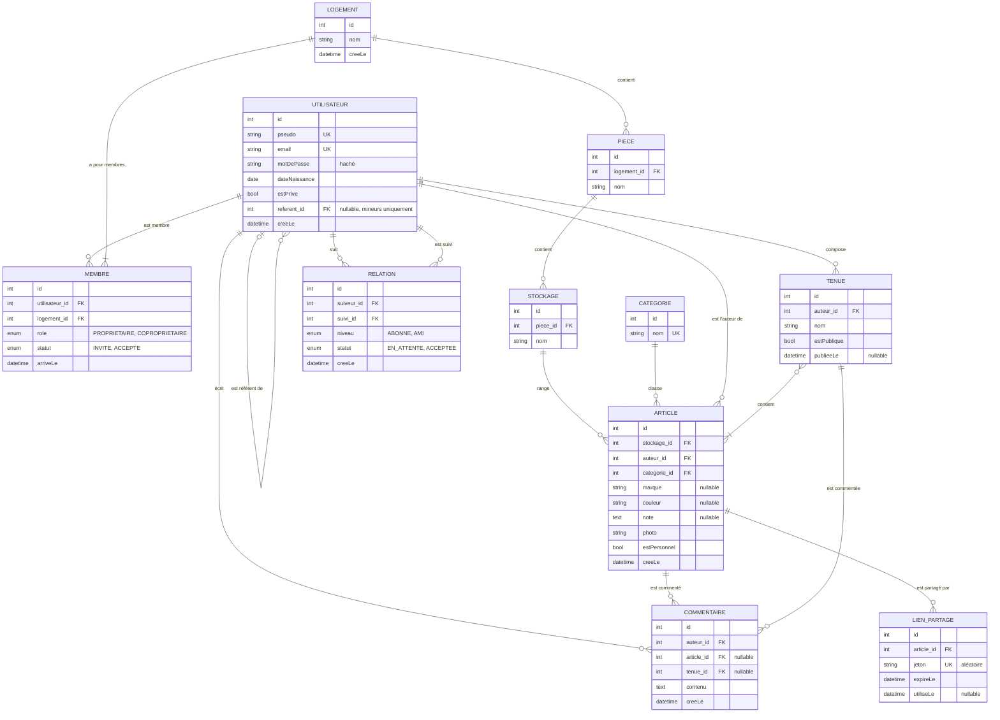

# Modèle de données – Version 1

- **Rédigé par** : Ethan Mauclair
- **Date** : 12/10/2026
- **Sources** : [périmètre V1](03-perimetre-v1.md), [parcours](04-parcours-utilisateurs.md), [échanges client](02-echanges-client.md), [journal de décisions](journal-decisions.md)
- **Statut** : à valider au pitch 1. Schéma draw.io à ajouter (`05-modele-donnees.drawio`).

---

## 1. Schéma

## 2. Les entités et leurs choix

| Entité | Rôle | Choix et justification |
|---|---|---|
| **Utilisateur** | Un compte | `estPrive` porte la confidentialité (D-006). `dateNaissance` permet le passage automatique à 18 ans. `referent` relie un mineur à son compte majeur ; il est **vidé à 18 ans** (le compte devient indépendant). |
| **Membre** | Lien utilisateur ↔ logement | **Une seule table pour propriétaire et co-propriétaires** : transférer un logement revient à changer un rôle, pas à déplacer une clé. `arriveLe` désigne le « premier arrivé » (Q-20). `statut` gère l'invitation (H13). |
| **Logement, Pièce, Stockage** | L'arborescence | Le logement n'a **pas** d'attribut privé/public : c'est le compte qui l'est (D-006). |
| **Article** | Un vêtement, un objet… | `auteur` est distinct du propriétaire du logement (H17) : c'est lui qui décide de la visibilité et de la suppression. Le logement se déduit de `stockage → pièce → logement` (pas de clé dupliquée). |
| **Catégorie** | Vinyle, pull, baskets… | **Liste fixe, extensible par l'administrateur** (D-013). La photo propose une catégorie de la liste ; l'utilisateur peut corriger. Pas de doublons « Vinyle / vinyles / vynile ». |
| **Tenue** | Assemblage d'articles | Relation plusieurs à plusieurs avec Article. `estPublique` = affichée sur le profil (Q-07). |
| **Relation** | Abonné ou ami | **Une seule table, deux niveaux** : rétrograder un ami en abonné = changer `niveau` (Q-08). `statut` gère la demande sur un compte privé. |
| **Commentaire** | Sur un article ou une tenue | Deux clés nullables, exactement une renseignée (I-12). |
| **LienPartage** | Accès sans compte | Jeton aléatoire non devinable, expiration à 24 h, usage unique (Q-19). |

## 3. Invariants

Règles que l'application garantit en permanence. Chacune devra être couverte par un test unitaire.

### Comptes
| # | Règle | Source |
|---|---|---|
| I-01 | Un compte **mineur** (moins de 18 ans) a **toujours** un référent **majeur**. Un compte majeur n'a **pas** de référent. | CR § 5, Q-11 |
| I-02 | À 18 ans, le référent est retiré : le compte devient **indépendant**. | Q-11, D-013 |
| I-03 | Supprimer un compte majeur supprime les comptes mineurs dont il est référent, **avec leurs articles**. | Q-11b |
| I-04 | Un compte qui est **propriétaire** d'au moins un logement **ne peut pas être supprimé**. | Q-12 |

### Logements
| # | Règle | Source |
|---|---|---|
| I-05 | Un logement a **exactement un** membre propriétaire. | CR § 5 |
| I-06 | Le propriétaire est **majeur**. Un mineur n'est **jamais** propriétaire. | Q-20 |
| I-07 | Un utilisateur est membre d'un logement **au plus une fois**. | — |
| I-08 | Un mineur ne crée pas de logement. | CR § 5 |
| I-09 | Quand le propriétaire supprime son logement : ses articles sont supprimés ; s'il reste des co-propriétaires **majeurs**, le plus **anciennement arrivé** devient propriétaire ; sinon le logement est supprimé entièrement. | D-011, Q-20 |

### Articles et tenues
| # | Règle | Source |
|---|---|---|
| I-10 | Un article est toujours rangé dans **un stockage** (pas de prêt ni de vente en V1). | E-02, E-05 |
| I-11 | L'auteur d'un article est **membre** (accepté) du logement où il est rangé. | — |
| I-12 | Un commentaire vise **exactement un** article **ou** une tenue. | — |
| I-13 | Une tenue ne contient que des articles **dont son auteur est l'auteur**. | P4 |
| I-14 | Une tenue contenant un article personnel est **privée par défaut** ; son auteur peut la rendre publique. L'article personnel n'est alors visible **que dans cette tenue**. | Q-21 |
| I-15 | Supprimer un article le retire des tenues ; une tenue devenue **vide est supprimée**. | D-013 |
| I-16 | Un mineur ne publie pas de tenue : `estPublique` reste faux. | CR § 5 |

### Relations et partage
| # | Règle | Source |
|---|---|---|
| I-17 | On ne se suit pas soi-même ; **une seule** relation par couple (suiveur, suivi). | — |
| I-18 | Une relation vers un compte **public** est acceptée d'office ; vers un compte **privé**, elle reste en attente jusqu'à acceptation. | Q-09, Q-03b |
| I-19 | Seul un **ami** (relation acceptée de niveau AMI) peut commenter. | Q-13 tour 2 |
| I-20 | Un lien de partage est valide **si et seulement si** `utiliseLe` est vide **et** `expireLe` n'est pas dépassé. Sa première ouverture renseigne `utiliseLe`. | Q-05, Q-19 |

## 4. Règle de visibilité d'un article

> Version complète, avec les tenues, les commentaires et les droits d'écriture : [06-modele-autorisation.md](06-modele-autorisation.md).

Un utilisateur **V** voit un article **A** (auteur **X**) si l'une de ces conditions est vraie :

1. **V est membre** (accepté) du logement de A → il voit tout, y compris les articles personnels, les pièces et les stockages ;
2. A **n'est pas personnel** **et** (le compte de **X** est **public** **ou** V a une relation **acceptée** avec **X**) → il voit l'article et le nom du logement, **pas** les pièces ni les stockages ;
3. V présente un **lien de partage valide** pour A.

> **Conséquence (D-013)** : on s'abonne à une **personne**, pas à un logement. Nora, abonnée de Camille, voit les articles **de Camille** dans l'appartement, mais **pas ceux de Léo**, même s'ils sont rangés dans le même logement : ils dépendent du compte de Léo et de sa confidentialité.

## 5. Questions ouvertes

| # | Question |
|---|---|
| Q-22 | Un compte **mineur** peut-il être **public** et avoir des abonnés ? Ou est-il forcément privé ? (protection des mineurs, RGPD) |
